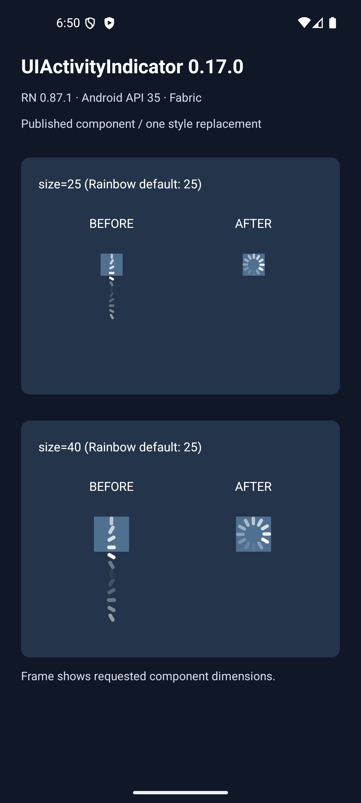

# UIActivityIndicator on React Native 0.87

Focused native reproduction for Rainbow upgrade PR #7785 at `21653288ba7a3390dd050d723bb5fc4b5c57041b`.

The branch pins `react-native-indicators@0.17.0`. Rainbow's `src/components/ActivityIndicator.tsx` renders its **UIActivityIndicator** with a default size of 25. This component is used in `LoadingOverlay`, `CarouselCard`, `ActivityList`, and `SecretDisplaySection`.

The dependency's `src/components/ui-activity-indicator/styles.js` spreads the removed `StyleSheet.absoluteFillObject` into each animated layer. Losing absolute positioning stacks the 12 bars vertically instead of overlapping their rotated frames. The attached patch changes only that spread to `StyleSheet.absoluteFill`.

## Verified environment

- React Native **0.87.1**, React **19.2.3**, Hermes, Fabric
- Android API 35, Pixel 7 emulator
- Embedded production JS bundle (`--dev false`), developer support disabled
- Actual npm `react-native-indicators@0.17.0` source copied twice, not a reimplementation or mocked renderer
- One copy unchanged; the other differs only in the single style replacement above
- Requested sizes 25 (Rainbow default) and 40 (library default)

The blue frame is the requested component size. Before: bars flow vertically outside it. After: a circular spinner fits inside it. Both copies animate.

## Reproduce

1. Create a disposable bare React Native 0.87.1 app, e.g. `npx @react-native-community/cli init IndicatorRepro --version 0.87.1` (Node 24).
2. Add `react-native-indicators@0.17.0` and its `prop-types` dependency.
3. Copy `node_modules/react-native-indicators` into app-root folders named `indicatorsBefore` and `indicatorsAfter`.
4. In `indicatorsAfter/src/components/ui-activity-indicator/styles.js`, replace `...StyleSheet.absoluteFillObject` with `...StyleSheet.absoluteFill`. Leave the other copy unchanged.
5. Replace the app's `App.tsx` with this file. Run the app on Android. Both examples render side by side without Rainbow or any wallet configuration.
6. For the exact production-bundle mode used here, embed an Android bundle with `--dev false`, disable `getUseDeveloperSupport` in the disposable app and build/install its debug APK.

## Scope

This is a component reproduction, **not a full Rainbow app build**. The tested RN patch version is 0.87.1; the upgrade branch pins 0.87.0. iOS and full-app navigation were not tested. The proposed patch intentionally touches only UIActivityIndicator, the exported indicator Rainbow actually uses. Other indicator variants are outside this change.

Found while validating a NativeKeel dependency warning; the native reproduction is the runtime evidence. No scanner output is treated as proof of a full-app failure.
